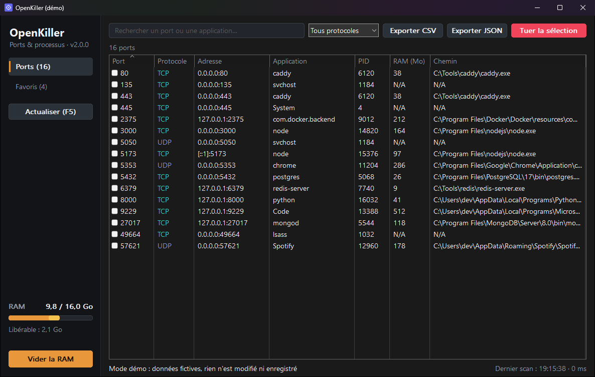
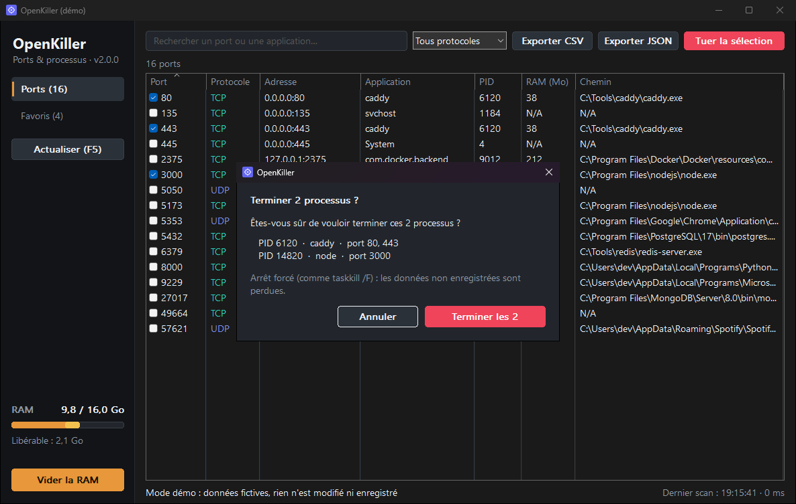
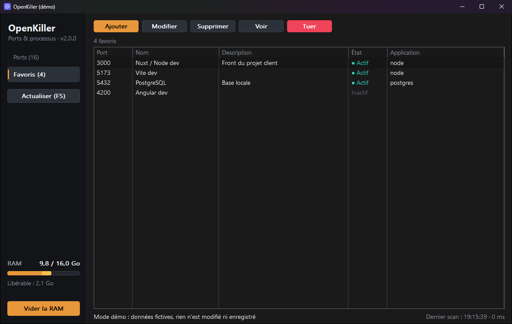
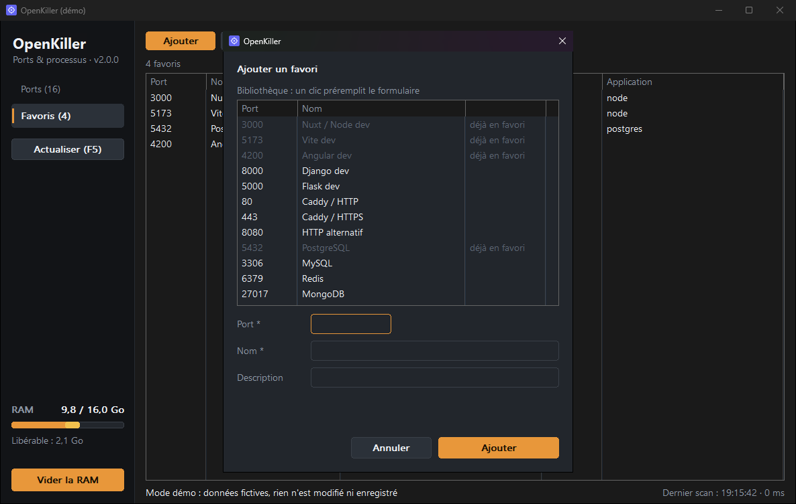

<p align="center"></p>

<h1 align="center">OpenKiller</h1>

<p align="center">Trouve qui occupe un port et libère-le en un clic : un exe Windows natif de 657 Ko, sans Electron, sans PowerShell, sans installeur.</p>

<p align="center">
  
  
  <a href="https://github.com/williamloree/OpenKiller/releases/latest"></a>
  <a href="https://github.com/williamloree/OpenKiller/actions/workflows/release-windows.yml"></a>
  
  
</p>

<p align="center">Fait par William Loree.</p>



OpenKiller liste les ports ouverts de ta machine, te dit quelle application les occupe (nom, PID, mémoire, chemin) et termine le processus en un clic. Il lit les tables de sockets de Windows directement (`iphlpapi`) : aucun `netstat`, aucun PowerShell lancé en arrière-plan. Un scan complet prend de 24 à 33 ms, contre environ 4,3 s pour la v1.

La v2 est une réécriture complète en Rust de la v1 Electron : un seul exe de 657 Ko (l'installeur de la v1 faisait 76,1 Mo), 4 Mo de mémoire privée au repos, et une fenêtre en thème sombre faite de contrôles Win32 natifs.

## Installer

1. Télécharge `openkiller.exe` depuis la [dernière release](https://github.com/williamloree/OpenKiller/releases/latest), avec `openkiller.exe.sha256` si tu veux vérifier le fichier.
2. Vérifie l'empreinte (facultatif) :
   ```powershell
   (Get-FileHash openkiller.exe -Algorithm SHA256).Hash.ToLower()
   Get-Content openkiller.exe.sha256
   ```
   Les deux valeurs doivent être identiques.
3. Range l'exe où tu veux (par exemple `%LOCALAPPDATA%\Programs\OpenKiller\`) et lance-le.

C'est tout : il n'y a pas d'installeur. Ensuite, OpenKiller se met à jour tout seul depuis les releases de ce dépôt. Il faut Windows 10 ou 11 (x64).

| Mode | Commande |
|---|---|
| Normal | `openkiller.exe` |
| Démonstration (données fictives, rien n'est écrit, aucun appel réseau) | `openkiller.exe --demo` |
| Mise à jour à la demande | `openkiller.exe update` |

Lancer l'exe une seconde fois ramène la fenêtre déjà ouverte.

## Ce que tu vois

| Dans la fenêtre | Signification |
|---|---|
| **Ports (N)** / **Favoris (N)**, barre latérale | Les deux vues, avec le nombre de lignes. |
| **Actualiser (F5)** | Rescanne tout de suite. Le scan se fait aussi seul toutes les 10 s, en gardant sélection, tri et défilement. |
| Colonnes **Port, Protocole, Adresse, Application, PID, RAM (Mo), Chemin** | Une ligne par (protocole, port, PID). Si IPv4 et IPv6 écoutent le même port, une seule ligne s'affiche. TCP : sockets en écoute. UDP : sockets liées. |
| **N/A** dans RAM ou Chemin | Processus système ou d'une autre session : Windows refuse de les lire sans droits administrateur. |
| Recherche, liste **Protocole** | Filtre à la frappe sur le port ou l'application (sans tenir compte de la casse) ; Tous, TCP ou UDP. Le compteur indique « N ports » puis « filtrés sur M ». |
| Clic sur l'en-tête **Port** ou **Application** | Tri croissant ou décroissant, flèche dans l'en-tête. |
| **Exporter CSV / JSON** | Exporte la liste affichée (donc filtrée) dans le fichier que tu choisis. |
| **Tuer la sélection** | Termine les processus des lignes cochées, après confirmation (voir plus bas). |
| **Jauge RAM**, en bas à gauche | Mémoire utilisée / totale, et part « libérable » (cache système). |
| **Vider la RAM** | Libère la mémoire physique que les applications ne réutilisent pas tout de suite. Relance l'exe en administrateur (UAC) pour cette seule opération. |
| Barre d'état, en bas | Dernier message et heure du dernier scan. |
| Menu système de la fenêtre (clic droit sur la barre de titre) | Rechercher une mise à jour, activer ou couper les mises à jour automatiques. |

### Terminer un processus



Coche une ou plusieurs lignes (ou `Ctrl+A`), clique sur « Tuer la sélection » ou appuie sur `Suppr`. La confirmation liste les PID distincts : deux lignes du même processus n'en font qu'un. L'arrêt est forcé, comme `taskkill /F` : les données non enregistrées sont perdues.

OpenKiller refuse de tuer les PID 0 et 4 et lui-même. Juste avant de tuer, il vérifie que le processus visé porte toujours le même nom (sinon : « Le processus a changé, actualise »). Si Windows refuse, la barre d'état affiche « Accès refusé (processus admin ?) ».

### Favoris



Épingle les ports qui comptent pour savoir d'un coup d'œil s'ils sont occupés. Boutons : Ajouter, Modifier, Supprimer, Voir (ouvre la vue Ports filtrée sur ce port), Tuer (si le port est actif).



La bibliothèque propose 12 ports courants : 3000 (Nuxt / Node dev), 5173 (Vite), 4200 (Angular), 8000 (Django), 5000 (Flask), 80 et 443 (Caddy), 8080, 5432 (PostgreSQL), 3306 (MySQL), 6379 (Redis), 27017 (MongoDB). Un clic préremplit le formulaire. Le port doit être entre 1 et 65535, le nom est obligatoire (100 caractères au plus), la description facultative (500 caractères au plus), et un port déjà en favori est refusé.

### Raccourcis clavier

| Raccourci | Effet |
|---|---|
| `Ctrl+F` | Place le curseur dans la recherche |
| `F5` | Actualise |
| `Suppr` | Tue la sélection (avec confirmation) |
| `Ctrl+A` | Sélectionne toutes les lignes de la liste active |
| `Échap` | Vide la recherche |

La navigation complète au clavier (`Tab`) fonctionne, et les contrôles natifs sont lus par les lecteurs d'écran.

## Venir de la v1

- **Les favoris ne sont pas migrés.** La v1 les gardait dans le stockage local d'Electron. Ressaisis-les, ou prends-les dans la bibliothèque.
- **Windows uniquement.** La v1 annonçait aussi macOS et Linux : la v2 n'en fait plus partie.
- **Désinstalle l'ancienne version** : Paramètres > Applications > Applications installées > Open Killer > Désinstaller.
- **La v1 n'a pas de mise à jour automatique** : télécharge la v2 à la main depuis la [dernière release](https://github.com/williamloree/OpenKiller/releases/latest). À partir de là, c'est automatique.
- Les exports CSV et JSON gardent les mêmes colonnes et les mêmes clés que la v1.
- La fenêtre est maintenant redimensionnable (900 × 560 au minimum) ; sa taille et sa position sont mémorisées.

## Mises à jour

Une minute après le lancement, puis toutes les 6 heures, OpenKiller consulte la dernière release de ce dépôt. Si elle est plus récente, il télécharge `openkiller.exe`, vérifie son empreinte SHA-256 (`openkiller.exe.sha256`), remplace son propre exécutable et redémarre. Désactivable dans le menu système de la fenêtre, ou en mettant `"auto_update": false` dans `config.json`. `openkiller.exe update` fait la même vérification tout de suite et affiche le résultat dans ton terminal.

Pour publier une version : augmenter `version` dans `Cargo.toml` et pousser sur `main`. Le workflow `.github/workflows/release-windows.yml` compile, teste et crée la release `vX.Y.Z` (avec `openkiller.exe` et `openkiller.exe.sha256`) si elle n'existe pas encore. Les releases existantes ne sont jamais touchées.

## Comment ça marche

| Fichier | Rôle |
|---|---|
| `Cargo.toml`, `build.rs`, `.cargo/config.toml`, `res/*` | Exe unique, runtime C statique, icône, manifeste (DPI v2, `asInvoker`), recherche des DLL limitée à System32. |
| `src/main.rs` | Arguments, sous-commandes, instance unique, relance après mise à jour. |
| `src/ports.rs` | Tables TCP/UDP via `iphlpapi`, dédoublonnage, scan. |
| `src/process.rs` | Nom, RAM, chemin, kill (refus des PID 0 et 4 et de soi, nom vérifié sur le handle). |
| `src/memory.rs` | Jauge RAM, `clean_ram` (`EmptyWorkingSet`), relance élevée. |
| `src/model.rs` | Filtre, tri, compteurs, validation des favoris, presets. |
| `src/export.rs` | CSV (anti-formules, BOM) et JSON. |
| `src/config.rs` | `%APPDATA%\openkiller\config.json`. |
| `src/demo.rs` | Données fictives. |
| `src/ui/*` | Fenêtre, thème sombre, dialogues, capture PNG (WIC). |
| `src/updater.rs` | Mise à jour depuis les releases GitHub (HTTPS, SHA-256). |

- Les appels sont directs à Win32 (crate `windows`, plus `serde_json`) : pas de webview, pas de processus externe.
- Les CSV sont en UTF-8 avec BOM (Excel), toutes les cellules entre guillemets, et une cellule qui commence par `=`, `+`, `-` ou `@` est préfixée d'une apostrophe pour éviter l'injection de formules.
- Les captures de ce README sont produites par l'appli elle-même : `openkiller.exe --screenshot fichier.png [--view ports|favorites|kill|presets]` ouvre la démo, affiche la vue demandée et écrit le PNG.

## Ce que ça coûte

Comparatif v1 (Electron) / v2 (Rust), mesuré sur ma machine (Windows 11, v1 = v1.0.3 installée, v2 = exe de release) :

| | v1 Electron | v2 Rust |
|---|---|---|
| Téléchargement | 76,1 Mo (installeur v1.2.0) | **657 Ko** (672 768 octets) |
| Taille sur le disque | 252 Mo | 657 Ko |
| RAM au repos | 307 Mo (working set, 4 processus), 202 Mo en privé | **23,4 Mo** (working set), **4,0 Mo** en privé |
| Démarrage jusqu'à la fenêtre | 0,7 à 1,1 s | ~190 ms (456 ms à froid) |
| Scan des ports | ~4,3 s (TCP seulement) | **24 à 33 ms** (~100 lignes TCP + UDP) |
| CPU au repos, sur 60 s | 766 ms pour Electron seul | 406 ms (0,04 % d'un processeur) |

Méthode :

- **Taille** : `cargo build --release`, puis `(Get-Item target\release\openkiller.exe).Length`. Taille du téléchargement de la v1 : champ `size` de l'asset de la release v1.2.0 dans l'API GitHub.
- **RAM** : lancer l'appli, attendre 20 s, lire `Get-Process openkiller` (`WorkingSet64`, `PrivateMemorySize64`). Pour la v1, somme des quatre processus Electron.
- **Démarrage** : `Start-Process`, puis on attend que `MainWindowHandle` soit non nul, avec un `Stopwatch`. 5 lancements.
- **Scan** : durée d'un scan complet affichée dans la barre d'état (v2) ; `netstat -ano` plus un PowerShell par PID pour la v1.
- **CPU** : différence de `TotalProcessorTime` sur 60 s à l'arrêt, divisée par le nombre de cœurs.

Ces chiffres sont des relevés ponctuels sur une seule machine : à titre indicatif.

## Sécurité

- **Lu** : les tables de sockets TCP/UDP et la liste des processus (nom, mémoire, chemin).
- **Écrit** : seulement `%APPDATA%\openkiller\config.json` (favoris, taille de la fenêtre, `auto_update` ; écriture atomique), les exports que tu choisis, et `openkiller.exe.new` / `.old` le temps d'une mise à jour.
- **Réseau** : uniquement pour la mise à jour, en HTTPS : `api.github.com` (dernière release) et le téléchargement des fichiers de la release sur GitHub. Rien d'autre, jamais en mode démo.
- **Droits** : l'appli tourne sans droits administrateur. Seule la sous-commande interne `clean-ram` passe par l'UAC ; elle n'accepte aucun argument, ne lit rien et se relance depuis le chemin de l'exe courant.
- **Vérifications** : l'exe téléchargé n'est installé que si son SHA-256 correspond à celui de la release. Noms et chemins de processus sont échappés dans les exports. `config.json` est lu avec tolérance : ports hors 1-65535, doublons et textes trop longs sont ignorés ou bornés. Le runtime C est lié statiquement (la CI échoue si `VCRUNTIME140.dll` apparaît dans les imports), et la recherche des DLL est limitée à System32.
- Aucun secret, aucune télémétrie.

## Compiler

```
cargo build --release        # target\release\openkiller.exe
cargo fmt --check
cargo clippy --all-targets -- -D warnings
cargo test
```

Il faut Rust stable (édition 2024) et la chaîne d'outils MSVC. Les captures se refont avec `target\release\openkiller.exe --screenshot assets\screenshots\ports.png`.

## Limites connues

- Windows 10/11 x64 uniquement.
- La mise à jour vérifie l'intégrité de l'exe (SHA-256) mais pas son origine : il n'y a pas de signature de code.
- RAM et chemin affichent « N/A » pour les processus système (accès refusé sans droits administrateur).
- Toutes les sockets UDP liées s'affichent (environ 60 sur une machine courante) : UDP n'a pas d'état « en écoute ». Le filtre Protocole permet de les masquer.
- La liste déroulante Protocole garde une bordure claire dans le thème sombre.
- L'affichage sur plusieurs écrans de densités différentes n'a pas été testé.
- Les favoris de la v1 ne sont pas importés.

## Licence

[MIT](LICENSE)
